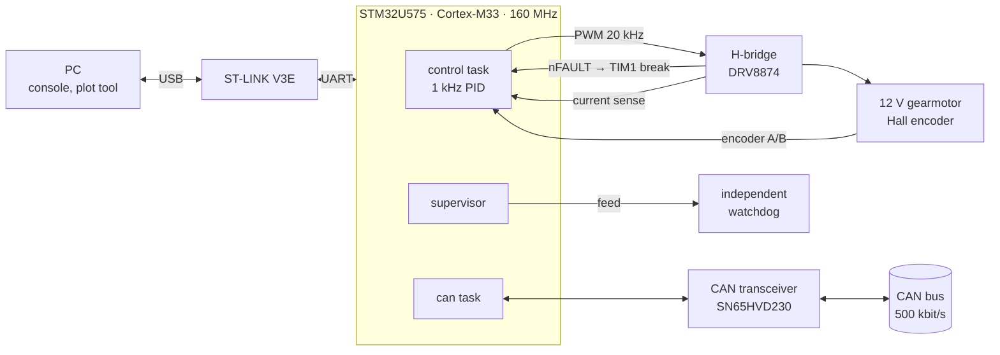
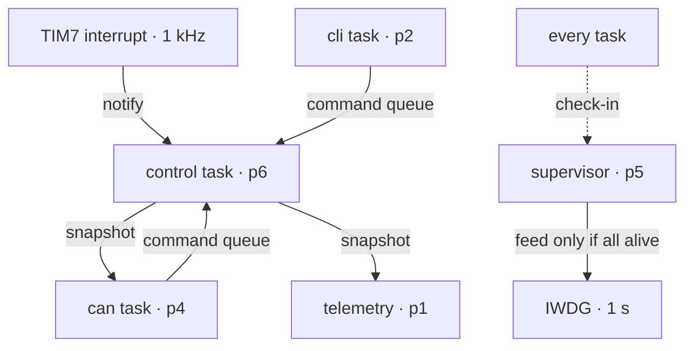

# STM32 Motor-Control ECU

**Real-time motor-control ECU on the STM32U575, built with FreeRTOS and C++20, with CAN networking and a fail-safe architecture.**


-03234B)


A complete electronic control unit (ECU) firmware for a DC gearmotor on the NUCLEO-U575ZI-Q:
- holds a commanded speed with a 1 kHz closed loop;
- takes commands over CAN or a serial console, and reports its state continuously;
- is designed so that every foreseeable failure ends with the motor stopped and a record
  of what happened.

## Highlights

- **1 kHz speed control.** A timer interrupt wakes the highest-priority task, which runs a PID
  with feedforward, anti-windup and bumpless mode transfer. Jitter and interrupt-to-task latency
  are measured with the CPU cycle counter.
- **PWM-synchronous current sensing with zero CPU load.** TIM1 triggers the ADC, and circular
  GPDMA fills a buffer without a single interrupt.
- **CAN node.**
  - The protocol is defined in a DBC file: 500 kbit/s on FDCAN.
  - Commands are protected by a CRC-8 and an alive counter.
  - A 250 ms command timeout stops the motor.
  - The node recovers from bus-off automatically.
- **Fail-safe architecture.**
  - A task supervisor feeds the independent watchdog only when every task is alive.
  - A hardware overcurrent trip uses the timer break input.
  - CPU faults are captured, survive the reset, and are written to a persistent flash
    fault log.
- **No heap.** All memory is statically allocated, and the build fails if `malloc` is ever linked.
- **Testable without hardware.** A simulated DC motor sits behind the same interface as the
  real one, and CAN internal loopback exercises the whole CAN stack. 97 host unit tests run in CI.

## Architecture



### Tasks and interrupts

| Task | Priority | Runs | Job |
|---|---|---|---|
| `control` | 6 (highest) | every 1 ms, woken by TIM7 | sensors → controller → PWM → status snapshot |
| `supervisor` | 5 | every 100 ms | check task deadlines, feed the watchdog |
| `can` | 4 | every 10 ms + each received frame | protocol, TX schedule, timeouts, bus-off recovery |
| `cli` | 2 | console input (200 ms timeout) | line editing, commands |
| `telemetry` | 1 | at the stream rate | `$T` lines for the plot tool |
| `heartbeat` | 1 | half the blink period | LED |

Interrupts: TIM7 control tick (priority 5); FDCAN1, USART1 and GPDMA (6); TIM6 HAL timebase (15).
The control task never blocks on another task: commands arrive through a queue, and status
leaves through a short critical section. The supervisor sits *below* the control task on
purpose: if the control loop ever spins forever, the supervisor starves and the watchdog
resets the MCU.



## Hardware

| Signal | Pin | Connects to |
|---|---|---|
| Console | PA9 / PA10 (USART1) | ST-LINK virtual COM port, 115200 8N1 |
| Heartbeat LED | PC7 | LD1 |
| Motor PWM | PE9 (TIM1_CH1, 20 kHz) | H-bridge EN |
| Direction | PF12 | H-bridge PH |
| Driver enable | PF13 | H-bridge nSLEEP |
| Driver fault + hardware trip | PE15 (TIM1_BKIN) | H-bridge nFAULT |
| Encoder A / B | PA0 / PA1 (TIM2, 32-bit) | Hall encoder (3.3 V supply) |
| Current sense | PA3 (ADC1_IN8) | H-bridge current-sense output |
| CAN RX / TX | PD0 / PD1 (FDCAN1) | SN65HVD230 transceiver |

**Parts:**
- NUCLEO-U575ZI-Q, with TrustZone disabled (the factory default)
- 12 V DC gearmotor with a quadrature Hall encoder
- H-bridge with PWM + direction inputs, current sense and a fault output (for example a
  DRV8874 carrier)
- SN65HVD230 CAN transceiver, with 120 Ω termination at each end of the bus
- optional: a USB-CAN adapter such as a CANable

All motor-specific values (encoder counts, gear ratio, sense gain, limits, gains) live in
[`src/app/motor_config.hpp`](src/app/motor_config.hpp).

## Getting started

**Tools:**
- [Arm GNU Toolchain](https://developer.arm.com/downloads/-/arm-gnu-toolchain-downloads) 12 or newer
- CMake 3.22 or newer, Ninja, Git
- STM32CubeProgrammer or OpenOCD

```bash
git clone --recurse-submodules https://github.com/Raguram-Kasthurisamy/stm32-motor-control-ecu.git
cd stm32-motor-control-ecu

cmake --preset debug && cmake --build --preset debug       # → build/debug/ecu_firmware.elf
STM32_Programmer_CLI -c port=SWD -w build/debug/ecu_firmware.elf -v -rst
picocom -b 115200 /dev/ttyACM0                             # console (PuTTY on Windows)
```

Host unit tests:
```bash
cmake -S test -B build/test -G Ninja && cmake --build build/test && ctest --test-dir build/test
```

**Try it without a motor:**
```
ecu> sim on
ecu> speed 120
ecu> motor        # speed settles near 120 rpm on the simulated motor
ecu> ctrl         # control-loop timing measured on the real chip
```

## Console commands

| Command | Purpose |
|---|---|
| `help`, `version`, `sysinfo`, `uptime`, `tasks`, `uart`, `reset` | system information |
| `motor` | mode, fault, setpoints, speed, duty, current |
| `duty <%>` · `speed <rpm>` · `stop` | drive the motor |
| `pid [kp ki kd]` | show or change the gains live |
| `sim on\|off` | simulated motor instead of hardware |
| `clear` | clear a latched fault |
| `ctrl [reset]` | loop timing: jitter, latency, execution time |
| `stream [hz\|off]` | telemetry for `tools/telemetry_plot.py` |
| `can [loopback on\|off]` | bus state, error counters, frame statistics |
| `cantx stop\|clear\|speed\|duty` | send a test command frame |
| `health` | task check-ins watched by the supervisor |
| `faults [clear]` | last fault and the flash fault log |
| `fault hang\|stack\|div0\|assert` | inject a fault on purpose |

## CAN protocol

Classic CAN at 500 kbit/s with 11-bit identifiers. Defined in [`protocol/ecu.dbc`](protocol/ecu.dbc).

| ID | Message | Direction | Period | Content |
|---|---|---|---|---|
| `0x100` | ECU_Command | → ECU | ≤ 250 ms while running | mode, target, alive counter, CRC-8 |
| `0x180` | ECU_Status | ECU → | 10 ms | mode, fault, speed, setpoint, duty |
| `0x181` | ECU_Measurements | ECU → | 10 ms | current, target speed, encoder count |
| `0x701` | ECU_Heartbeat | ECU → | 100 ms | state, reset cause, uptime |

From a PC, with a USB-CAN adapter:
```bash
pip install -r tools/requirements.txt
python tools/can_monitor.py --interface gs_usb --channel 0 --speed 120
```

## Safety design

| Failure | Detected by | Response |
|---|---|---|
| Task deadlock or infinite loop | supervisor deadlines | motor off, fault recorded, watchdog reset |
| Supervisor stops | independent watchdog | hardware reset |
| Driver overcurrent | nFAULT → TIM1 break | PWM cut in hardware, latched |
| Encoder lost, shaft jammed, encoder reversed | plausibility checks | latched fault |
| CAN commander silent or frozen | timeout + alive counter | motor stops |
| Stack overflow | PSPLIM / MSPLIM | fault captured, reset |
| Bad pointer, divide by zero | CPU fault handlers | registers captured, reset |

Every fault record survives the reset, is printed at boot, and is appended to a flash page
that reflashing does not erase.

## Results

Measured on hardware (in progress):

| Metric | Method | Result |
|---|---|---|
| Control-loop jitter | `ctrl` (cycle counter) | TBD |
| Interrupt-to-task latency | `ctrl` | TBD |
| Step response 0 → 120 rpm (overshoot, settling) | telemetry plot | TBD |
| CAN timeout → motor stop | `can_monitor.py` | TBD |
| nFAULT → PWM off | logic analyser | TBD |
| Flash / RAM usage | build output | TBD |

## Repository layout

```
src/app        tasks, console commands, motor configuration
src/system     fatal path, crash record, flash fault log
src/drivers    DMA UART driver, hardware motor I/O
src/os         FreeRTOS C++ wrappers (static tasks, mutex)
lib/           portable, unit-tested code: control, protocol, safety, cli, io
bsp/           board support for NUCLEO-U575ZI-Q
protocol/      ecu.dbc
tools/         telemetry_plot.py, can_monitor.py
test/          host unit tests (GoogleTest, ASan, UBSan)
docs/          project guide (PDF)
third_party/   FreeRTOS, CMSIS, STM32U5 HAL (pinned submodules)
```

## Possible extensions

Vibration monitoring with an SPI IMU and an FFT; a CAN bootloader using the U575's dual-bank
flash.

## Author

**Raguram Kasthurisamy**